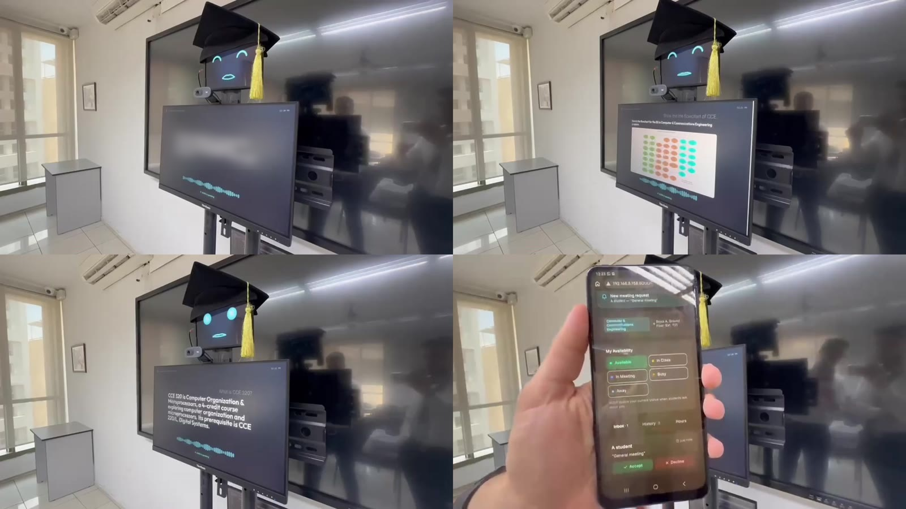
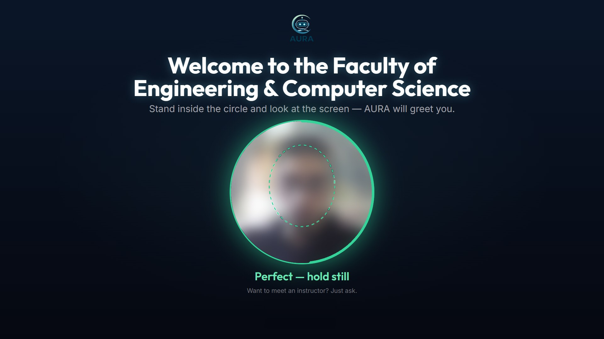
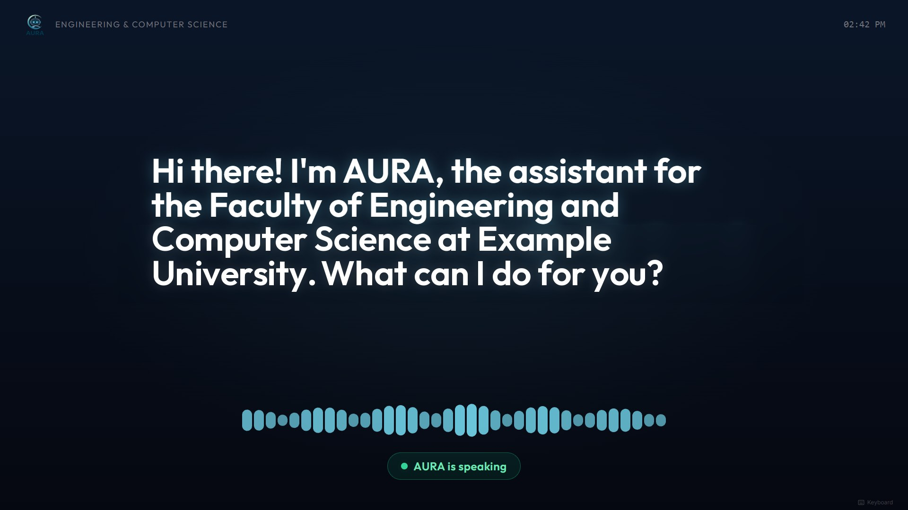
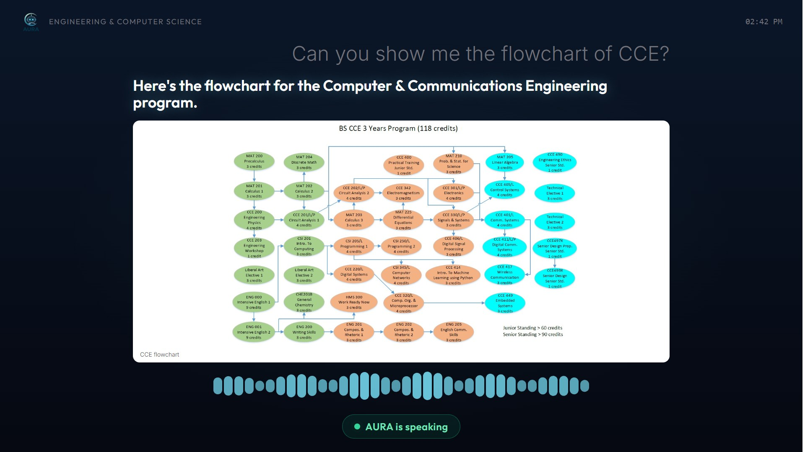
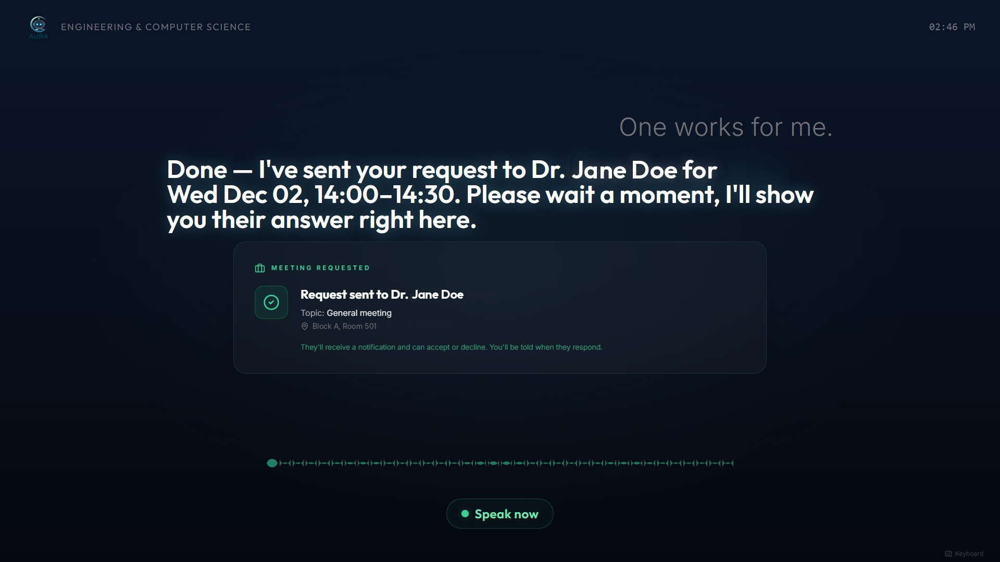
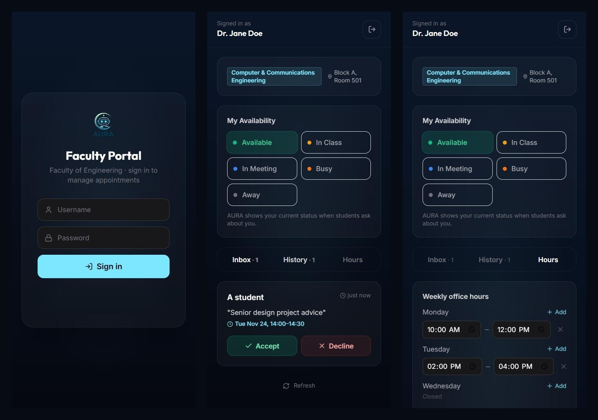

# AURA — Automated Unified Reception Assistant

A voice-first AI reception kiosk that greets visitors, answers questions about a university faculty, and books meetings with instructors.

**Built:** June 2026 · Senior design project


## Demo

**Demo video** (1 min 45 s): a visitor walks up, AURA wakes, answers course questions, shows a flowchart, books a meeting, and the instructor accepts from a phone. Names and logos on the kiosk screen are blurred.

## Screenshots

**The kiosk in action**



**Kiosk screens**

| Welcome: the camera checks that someone is facing the kiosk (face blurred) | Greeting |
| --- | --- |
|  |  |
| **Answering with a program flowchart** | **Booking a meeting with an instructor** |
|  |  |

**Animated avatar (lip-syncs to AURA's voice)**


**Instructor app (phone)**



**Admin dashboard**


## Results

Evaluated on 32 visitor questions, with answers checked against the source data:

| Metric | Result |
| --- | --- |
| Answer accuracy | 91% (29 of 32) |
| Off-topic questions safely declined | 4 of 4 |
| Average time to spoken reply | 3.9 s |

## How it works

1. **Notices you.** A camera watches for a visitor who stands close and looks at the screen for 2.5 seconds, then AURA wakes and greets them.
2. **Listens.** Speech is transcribed in real time and filtered for noise and non-English input.
3. **Answers from real data.** A retrieval-augmented (RAG) GPT-4o pipeline answers only from the faculty's own knowledge base, so it does not make things up.
4. **Speaks and shows.** An animated avatar speaks the answer with lip-sync, while a second screen shows an info card (instructor, location, program, flowchart).
5. **Books meetings.** Visitors can request a meeting; the instructor accepts or declines from a phone web app.
6. **Forgets you.** When the visitor leaves for 7 seconds, AURA resets and wipes the conversation for privacy.

## Architecture

```
 Webcam ─► MediaPipe Face Landmarker (in browser, offline)
                │ visitor engaged
 Mic ───► Speech-to-text (OpenAI gpt-4o-transcribe │ faster-whisper offline)
                │ text
                ▼
        FastAPI backend ──► RAG: embeddings search ─► GPT-4o (JSON mode)
                │                 reply + card + expression + action
                ▼
 Text-to-speech (gpt-4o-mini-tts │ edge-tts offline) + viseme timings
                │
   ┌────────────┼──────────────────┬───────────────────┐
 /face        /display           /faculty            /admin
 avatar       info cards         instructor inbox    roster, knowledge,
 lip-sync     + wake logic       + web push          media management
```

## Tech stack

| Layer | Tools |
| --- | --- |
| Frontend | React 18, Vite, Tailwind CSS, Framer Motion, React Router |
| Computer vision | MediaPipe Face Landmarker (WASM, runs offline in the browser) |
| Backend | Python, FastAPI, Uvicorn |
| AI | OpenAI GPT-4o, text-embedding-3-small, gpt-4o-transcribe, gpt-4o-mini-tts |
| Offline fallbacks | faster-whisper (speech-to-text), edge-tts (text-to-speech) |
| Data | JSON file store, NumPy vector index with cosine similarity |
| Knowledge ingestion | BeautifulSoup, Playwright, PyMuPDF, pypdf, python-docx |
| Notifications | Web Push (VAPID) via pywebpush |
| Hardware | Mini-PC, 24" info display, 10" face screen, webcam, USB microphone |

## Engineering notes

- **RAG over a general chatbot** keeps answers grounded in the institution's real information.
- **Perception runs on-device.** Presence detection happens in the browser and no camera images are stored.
- **Cloud first, offline fallback.** Speech recognition and synthesis switch to local models when the network drops.
- **Gaze-based wake-up** (face size, yaw within 22°, pitch within 20°, held 2.5 s) avoids false triggers from people walking past.
- **No database server.** Atomic JSON files keep the kiosk simple to deploy and maintain.
- **Institution-neutral.** The university name, faculty, campuses and scraper sources live in `.env` and `tools/sources.json`, so the same code runs at any faculty.

## Repository layout

```
backend/
  main.py            FastAPI app, CORS, static files
  db.py              JSON store: faculty, appointments, knowledge, media
  routes/            chat, faculty, admin, push endpoints
  services/          rag, brain (vector index), stt, tts, scheduling, push
  config.py          institution, faculty and campus names (from .env)
  tools/             scrape the faculty website and build the knowledge index
data/                sample data (demo instructors, FAQ, settings)
media/               demo video and screenshots
frontend/
  src/pages/         Face, Display, Faculty, Admin, CameraTest
  src/components/    Avatar, Cards, managers for knowledge, media, schedule
  src/lib/           usePresence (MediaPipe), recorder, face channel
  public/mediapipe/  offline face-landmark model and WASM runtime
```

## Run it (Windows)

**You need:** Windows 10 or 11, Python 3.10–3.12, Node.js 18+, Chrome or Edge, a webcam and microphone, and an OpenAI API key. AURA uses the OpenAI API for answers and speech, so it needs internet.

### Quick start with the demo data (about 10 minutes)

1. **Install the backend.** Open PowerShell in the `backend` folder (type `powershell` in File Explorer's address bar there) and run:

   ```powershell
   python -m venv venv
   .\venv\Scripts\python -m pip install -r requirements.txt
   copy .env.example .env
   ```

2. **Add your key.** Open `backend\.env` in Notepad and paste your OpenAI key after `OPENAI_API_KEY=`. Optionally set `INSTITUTION_NAME`, `FACULTY_NAME` and `CAMPUSES` to your own. To show those names on the kiosk screens too, also copy `frontend\.env.example` to `frontend\.env` and set them there before the first start. Never commit `.env` files (they are in `.gitignore`).

3. **Build AURA's knowledge index** from the sample FAQ and instructors in `data/`:

   ```powershell
   .\venv\Scripts\python -m tools.ingest
   ```

4. **Start it.** Double-click `START-AURA.bat` in the main folder. The first start installs and builds the web app (1–2 minutes), then opens the kiosk and instructor pages. Allow camera and microphone access in the browser.

### Use your own faculty's information (optional)

1. In `backend\.env`, set `FOE_SCRAPE_URL` to your faculty website (it must have a `sitemap.xml`).
2. Install the browser the scraper uses, then scrape and rebuild the index:

   ```powershell
   .\venv\Scripts\python -m playwright install chromium
   .\venv\Scripts\python -m tools.scrape_foe
   .\venv\Scripts\python -m tools.ingest
   ```

   `python -m tools.scrape_foe --file urls.txt` scrapes only the pages listed in a text file.
3. For program flowcharts and course lists published as PDFs, copy `tools\sources.example.json` to `tools\sources.json`, put your links in it, and run `python -m tools.scrape_pdfs` and `python -m tools.build_catalog` before `tools.ingest`.
4. Replace the demo instructors, FAQ and offices in `data/`, or manage them from the `/admin` page.

### If something goes wrong

| Problem | Fix |
| --- | --- |
| `No module named 'openai'` (or another module) when the server starts | The `venv` is missing or incomplete: repeat step 1 of the quick start. |
| `Activate.ps1 cannot be loaded` | You don't need to activate the venv: run the commands with `.\venv\Scripts\python` as shown. |
| AURA can't answer questions about the faculty | The knowledge index is empty: run step 3 (`tools.ingest`). |
| The page says "no built frontend" | Run `npm install` and `npm run build` in `frontend`, or delete `frontend\dist` and start `START-AURA.bat` again. |
| A phone can't open the instructor page | The phone must be on the same Wi-Fi, and Windows Firewall must allow port 8000. |

### Pages

On the kiosk PC the pages are at `http://localhost:8000/...`; for phones, `START-AURA.bat` shows the PC's Wi-Fi address.

| Route | Device | Purpose |
| --- | --- | --- |
| `/display` | Kiosk PC | Info cards and wake-up logic |
| `/face` | Face screen | Avatar with lip-sync |
| `/faculty` | Instructor phone | Meeting requests and availability |
| `/admin` | Staff laptop | Manage instructors, knowledge, media |

Demo instructor login: `jdoe` / `demo1234` (sample data only).

## Limitations and next steps

- Prototype authentication: demo passwords are stored in plain text. Production use needs hashed credentials and proper sessions.
- The language model runs in the cloud; a local model fallback is planned.
- English only for now; multi-language support is future work.

## Author

**Michel Salame** — [LinkedIn](https://www.linkedin.com/in/michel-salame)
